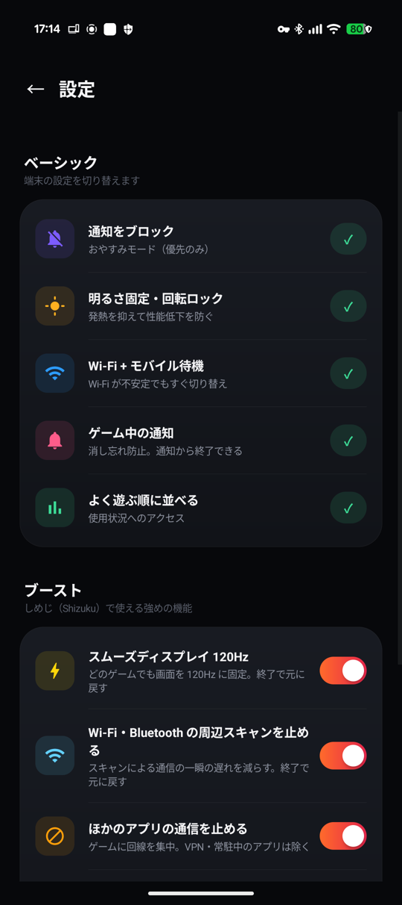

<div align="center">


# GameMode

**ワンタップで、スマホを「ゲームのための状態」に。**

ゲームを選んで START を押すだけ。通知・画面・通信・ほかのアプリをまとめてゲーム向けに切り替え、
遊び終わったら STOP ひとつで全部元に戻します。


</div>

---

## 特長

- **PSP のようなホーム画面** — 選んだゲームの公式 PV が START ボタンの後ろで流れます。PV が流れ出すと、UI はそっと脇へよけます
- **すりガラスの START ボタン** — 押すと裏で準備を進め、終わったらそのままゲームを起動
- **よく遊ぶ順のライブラリ** — 直近 30 日のプレイ時間で自動で並び替え
- **消し忘れない** — ゲームモード中は通知に経過時間と「終了」ボタンを常に表示
- **かならず元に戻す** — 変えた設定はすべて記録し、終了時に元の値へ戻します

<div align="center">

</div>

## ゲームモードでやること

### ベーシック（root も Shizuku も不要）

| | 内容 |
|---|---|
| 🔕 通知をブロック | おやすみモード（優先のみ）に切り替え |
| ☀️ 明るさ固定・回転ロック | 自動調整を止めて、発熱による性能低下を防ぐ |
| 📶 Wi-Fi + モバイル待機 | Wi-Fi が不安定になってもすぐモバイル通信へ切り替えられるよう待機させる |
| 🔔 ゲーム中の通知 | 経過時間と「終了して元に戻す」ボタン |
| 🧹 メモリを空ける | バックグラウンドのアプリに終了をお願いする |

### ブースト（[Shizuku](https://shizuku.rikka.app/) を使う強めの機能）

| | 内容 |
|---|---|
| ⚡ スムーズディスプレイ 120Hz | 画面を 120Hz に固定 |
| 📡 周辺スキャンを止める | Wi-Fi・Bluetooth の常時スキャンを OFF |
| ⛔ ほかのアプリの通信を止める | ゲームに回線を集中させる |
| 🌙 ほかのアプリの裏での動作を禁止 | 勝手に起きて重くなるのを防ぐ |
| 🧠 アプリを強制終了してメモリ確保 | 動いているアプリを止める |
| 🔋 バッテリーセーバーを OFF | 省電力による性能制限を外す |
| ⏹ STOP でゲームも終了 | 最近使ったアプリの履歴からも消す |

どれも設定画面で個別に ON / OFF できます。
止めるとまずいアプリ — **ゲーム本体・VPN・自動入力・ホーム・キーボード・常駐通知を出しているアプリ（音楽・イヤホンなど）** — は対象から外します。

## インストール

### 1. ビルド

```bash
./gradlew assembleDebug          # app/build/outputs/apk/debug/app-debug.apk
```

リリース版は、`~/.android/gamemode-release.properties` に署名鍵の情報を置いてから:

```properties
storeFile=/home/you/.android/gamemode-release.jks
storePassword=...
keyAlias=gamemode
keyPassword=...
```

```bash
./gradlew assembleRelease        # app/build/outputs/apk/release/app-release.apk
```

### 2. 権限

アプリ内の「⚙ 設定」で「許可」を押すと、それぞれの設定画面が開きます。
一部の権限は PC から adb で付けます:

```bash
PKG=com.example.gamemode
adb install app/build/outputs/apk/release/app-release.apk
adb shell pm grant $PKG android.permission.WRITE_SECURE_SETTINGS   # Wi-Fi + モバイル待機
# 以下は画面からでも許可できます
adb shell pm grant $PKG android.permission.POST_NOTIFICATIONS
adb shell appops set $PKG WRITE_SETTINGS allow
adb shell appops set $PKG GET_USAGE_STATS allow
adb shell cmd notification allow_dnd $PKG
```

### 3. Shizuku（ブーストを使う場合）

[Shizuku](https://shizuku.rikka.app/) をインストールして起動し、設定画面の「しめじ（Shizuku）を接続」から許可します。
root なしの Shizuku は再起動で止まり、自動では起動できません。再起動後は GameMode が「しめじが止まっています」という通知を出し、ワイヤレスデバッグを ON にしておくので、通知をタップして Shizuku の「開始」を押してください。

## しくみ

```
START ─┬─ 元の設定を保存（明るさ・通知・120Hz・スキャン・アプリごとの状態 …）
       ├─ ゲーム向けに切り替え（重い処理は並列・裏で実行）
       ├─ 通知を表示
       └─ ゲームを起動

STOP ──┬─ 保存しておいた値に戻す
       ├─ Shizuku の接続を待ってから、120Hz・通信・裏での動作を元に戻す
       └─ ゲームを終了して履歴からも消す（設定で OFF にできます）
```

- 戻しきれなかった設定は記録に残り、次にアプリを開いたときに改めて戻します
- PV は Google Play のページに載っている公式 PV を、YouTube の埋め込みプレーヤーで再生しています（動画は保存しません）

## 注意

- **ゲームモード中に端末を再起動しないでください。** 「裏での動作を禁止」がかかったままになります。その場合は Shizuku を起動してからアプリを開き、STOP を押してください
- CPU / GPU のクロックアップや発熱制限の解除はできません（root が必要です）
- ゲーム自身が決めているフレームレートの上限は外せません
- 「周辺スキャンを止める」で止まるのは常時スキャンだけです。接続中に Android が行うスキャンは root なしでは止められません

## 構成

```
app/src/main/java/com/example/gamemode/
├── MainActivity.java   画面（ホーム・ライブラリ・設定・PV）
├── GameMode.java       開始 / 終了と、元に戻す処理
└── StopReceiver.java   通知の「終了」ボタン
```

外部ライブラリは Shizuku の API だけです。UI は AndroidX を使わず、Android 標準の View で組んでいます。

## ライセンス

[MIT License](LICENSE) © 2026 ninjin0802

使っているライブラリ: [Shizuku API](https://github.com/RikkaApps/Shizuku-API)（Apache License 2.0）

## 免責

個人用に作ったアプリです。端末の設定を変更するため、自己責任で使ってください。
ゲーム名・アイコン・PV などの権利は、それぞれの権利者に帰属します。
